# DQMonitor — Data Quality Monitoring Platform

Enterprise data quality platform built for Enhanced Technologies: upload a dataset,
run a configurable quality analysis against it (Spark + Great Expectations), and
track results — scores, anomalies, trends — across your organization.

Built during my internship at Enhanced Technologies (Rabat, July to August 2026), as part of the Data Science and Artificial Intelligence engineering program at ENSA Fès.

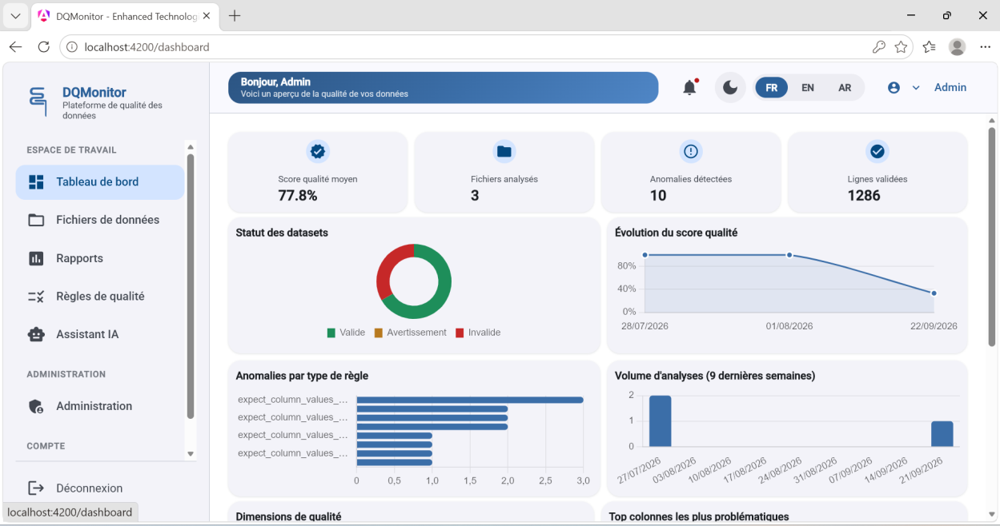

## Stack

| Layer | Technology |
|---|---|
| Frontend | Angular 22 (standalone components, signals, OnPush), Angular Material 3, Transloco (FR/EN/AR incl. RTL), Chart.js |
| Backend | Spring Boot 3.5 (Java 17), Spring Security + JWT (access + rotating refresh tokens), Flyway, Caffeine cache |
| Database | MySQL 8.0 |
| Data processing | FastAPI microservice wrapping PySpark + Great Expectations |
| Mail | Spring Mail (MailHog for local dev, any real SMTP in production) |
| Monitoring | Spring Boot Actuator (health/metrics/Prometheus), Docker healthchecks on every service |
| API docs | springdoc-openapi / Swagger UI |
| Testing | JUnit 5 + Mockito + Spring Boot Test (backend), Vitest (frontend), Playwright (E2E) |
| CI | GitHub Actions (backend test+package, frontend test+build, Docker image builds) |

## Features

- **Auth**: JWT access tokens (15 min) + opaque, DB-validated, rotating refresh tokens (7 days, revocable); per-account and per-IP login rate limiting; forgot/reset password via email.
- **Datasets**: drag-and-drop upload, one-click analysis, backoff-polling status (PENDING → PROCESSING → COMPLETED/FAILED).
- **Validation rules**: admin-managed, per-column rules (not-null, unique, regex, range, enum, required-column) that drive the Great Expectations suite built at analysis time — no rules configured falls back to not-null + no-duplicates.
- **Quality reports**: paginated history, drill-down detail view per check, dashboard KPIs and trend/distribution charts.
- **Administration**: paginated user management, role assignment, audit-log viewer, and a danger zone (full database reset) gated behind a typed confirmation.
- **Settings**: change password, switch language (persists via Transloco, RTL-aware for Arabic).
- **i18n**: every page and dialog, not just login/register — FR/EN/AR with full RTL layout mirroring.
- **Accessibility**: keyboard-navigable tables, aria-labelled icon-only buttons, described chart canvases, skip-to-content link.
- **Anomaly explorer and correction**: anomalies listed per row, column and rule; values can be corrected in the interface, the corrected file is downloaded or re-analysed, and every correction is kept in a history.
- **PDF export**: per-report PDF (summary + per-check table) via `GET /api/reports/{id}/pdf`.
- **AI Assistant**: chat grounded in the platform's own data (dashboard summary, active rules, dataset/report lookups via SQL — no vector store needed for structured relational data). Provider-abstracted (`app.ai.provider`): Ollama by default (free, local, offline), or Anthropic/OpenAI via env vars only, no code change.
- **Scheduled analysis (Airflow)**: a DAG (`airflow/dags/scheduled_quality_analysis.py`) sweeps datasets uploaded-but-never-analyzed every 15 minutes and triggers the same analysis pipeline the manual "Analyze" button uses, via a small internal API (`/internal/datasets/pending`, `/internal/datasets/{id}/analyze`).
- **Ops dashboards (Grafana)**: a provisioned dashboard (`grafana/provisioning/`) reading directly from MySQL via a dedicated read-only user — dataset throughput and status breakdown, quality score trend, active rules/users, and recent audit activity. Complements, rather than duplicates, the in-app Dashboard's end-user KPIs.

## Screenshots

**Quality reports**: every analysis produces a score, the number of anomalies and the result of each validation rule, exportable as PDF.

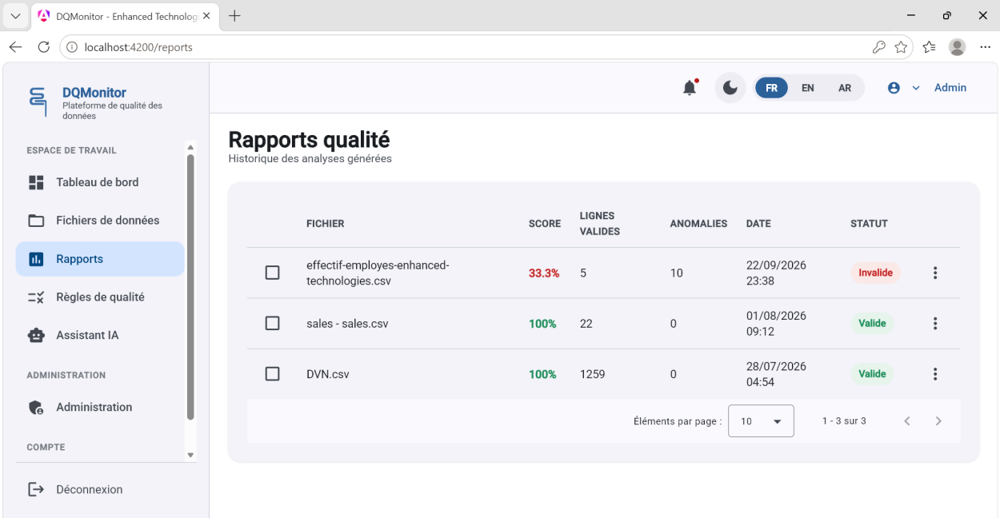
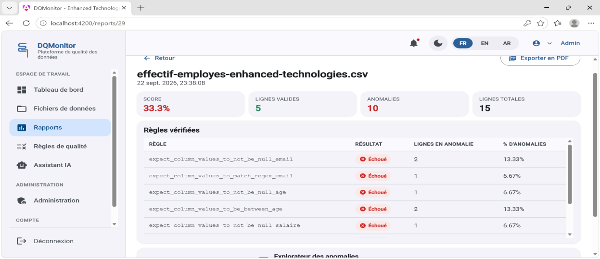

**Anomaly explorer and correction**: anomalies grouped by column, rule or check type, corrected directly in the interface; the corrected file is re-analysed and reaches a 100% score.

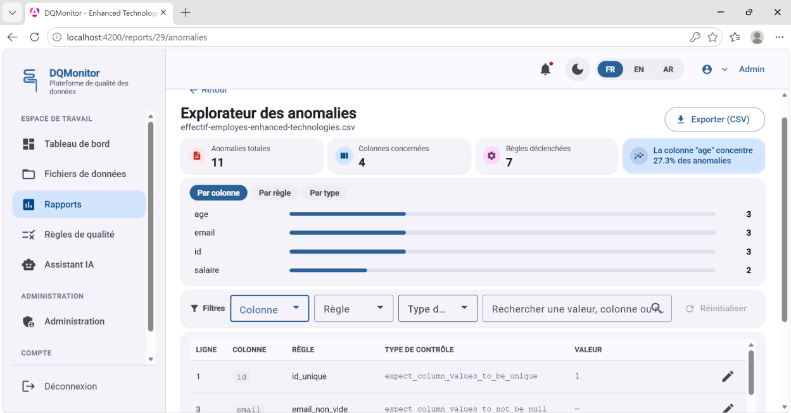
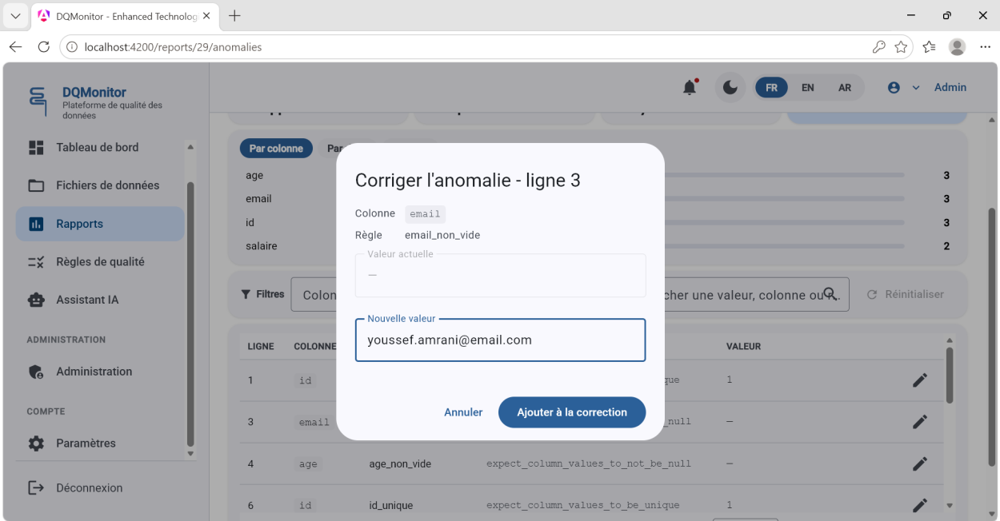
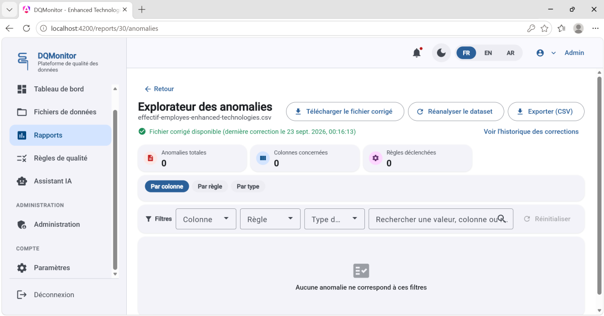

**AI assistant** answering questions about the platform's own datasets, rules and reports.

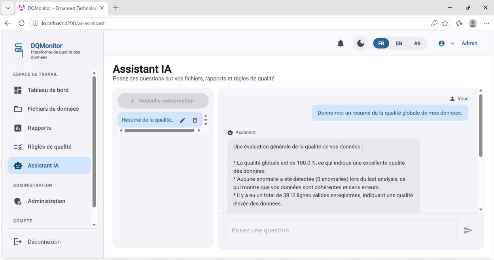

**Administration** (users, roles, audit log) and **settings** (language, light and dark theme).

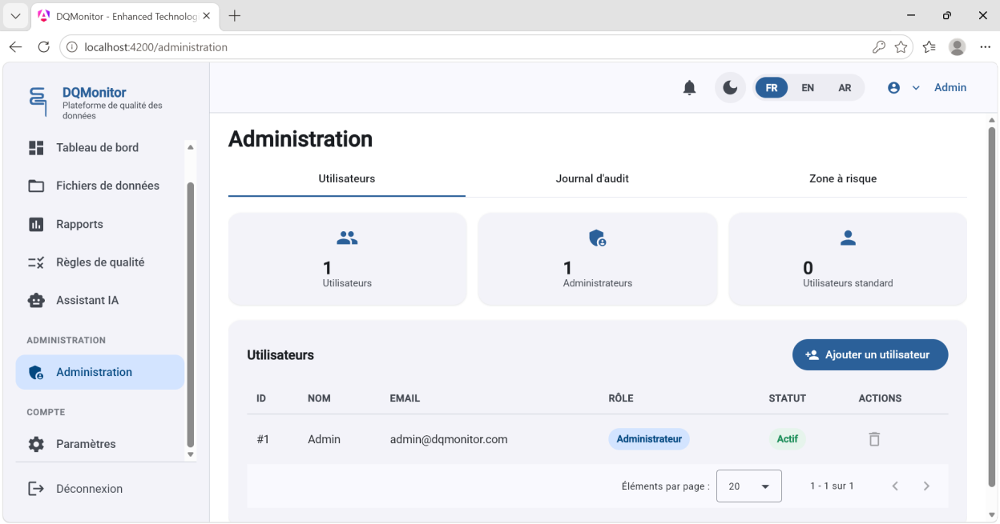
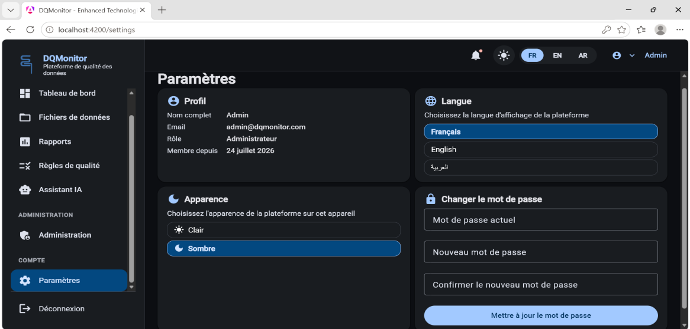

**Operations**: Grafana dashboard on MySQL, Airflow DAG for scheduled analyses, and the containers running with Docker Compose.

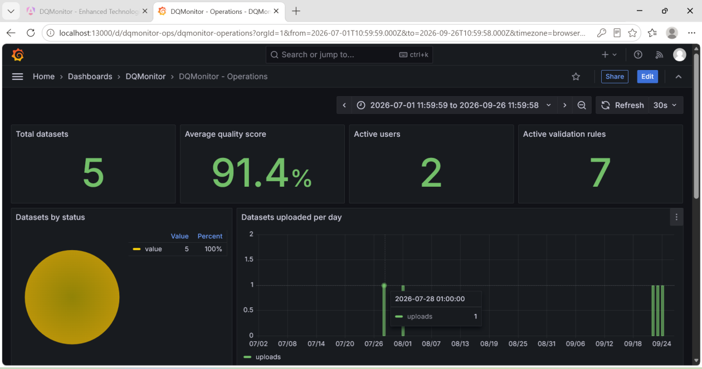
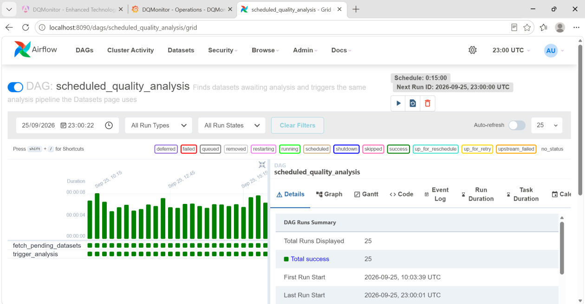
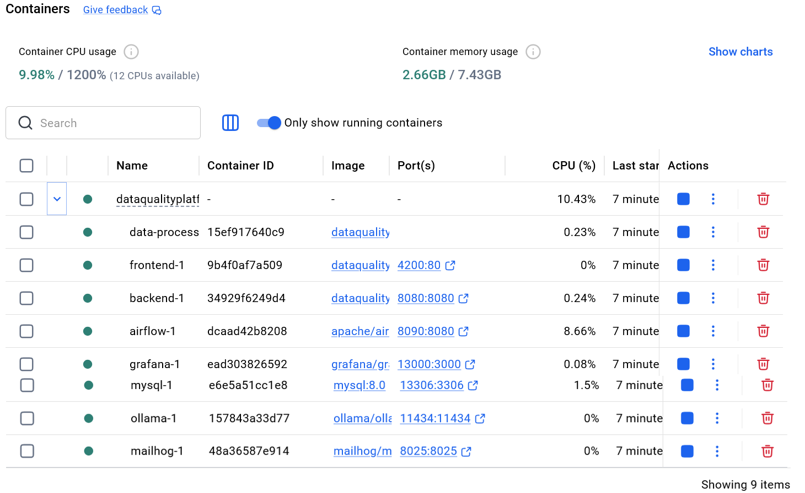

## Architecture

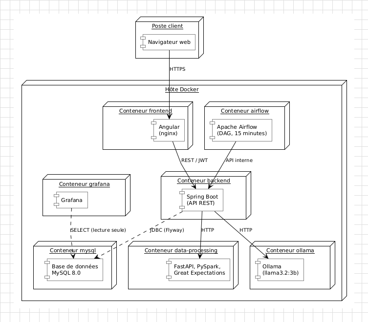

```
frontend (Angular SPA, nginx in prod)
      |  JWT bearer (same-origin /api in prod via nginx reverse proxy)
      v
backend (Spring Boot REST API) --Flyway--> MySQL
      |
      |  HTTP, ANALYSIS_SERVICE_URL configured (Docker) --------+
      |  ProcessBuilder fallback, ANALYSIS_SERVICE_URL empty    |  (local dev, no Docker)
      v                                                          v
data-processing (FastAPI + PySpark + Great Expectations)
      |
      |  fetches active validation rules, posts results back
      v
POST /internal/reports (shared-secret X-Internal-Key, not JWT)
```

The Python job owns no database credentials and never writes to MySQL directly —
it fetches active validation rules from the backend and posts results back over
HTTP, so the schema has exactly one owner (the JPA layer). `DatasetService` picks
between calling the analysis service over HTTP or spawning it via `ProcessBuilder`
based on whether `ANALYSIS_SERVICE_URL` is set, so the same backend code runs
identically in Docker and in plain local development.

See [`docs/ARCHITECTURE.md`](docs/ARCHITECTURE.md) for the full write-up (security
model, scalability decisions, i18n contract, testing strategy).

## Running with Docker Compose (recommended)

```bash
cp .env.example .env   # fill in real secrets - never commit .env
docker compose up --build
```

Starts `mysql`, `backend`, `data-processing`, `mailhog`, `frontend` (nginx,
reverse-proxying `/api` to the backend so the browser never needs CORS), `ollama`
(local AI provider), `airflow` (scheduled analysis), and `grafana` (ops
dashboards). Every service has a healthcheck; `docker compose ps` shows them
all reach `healthy`.

- App: http://localhost:4200
- API docs (Swagger UI): http://localhost:8080/swagger-ui/index.html
- MailHog web UI (catches all outgoing mail in dev): http://localhost:8025
- Actuator health: http://localhost:8080/actuator/health
- Airflow UI: http://localhost:8090 (see the standalone-mode admin password with
  `docker compose logs airflow | grep password`)
- Grafana: http://localhost:3000 (`GRAFANA_ADMIN_USER` / `GRAFANA_ADMIN_PASSWORD`)
  — the MySQL data source and "DQMonitor - Operations" dashboard are
  provisioned automatically, nothing to configure by hand.

Ollama's image doesn't bundle any model - after the first `docker compose up`,
pull one once with `docker compose exec ollama ollama pull llama3.2:3b` (or
whatever `OLLAMA_MODEL` is set to). Until a model is pulled, the AI Assistant
returns a clear "temporarily unavailable" error rather than failing silently.

If any of those default ports collide with something already running on your
machine, override them — see the "Host port overrides" section at the bottom of
`.env.example` (`MYSQL_HOST_PORT`, `BACKEND_HOST_PORT`, `FRONTEND_HOST_PORT`,
`MAILHOG_HOST_PORT`, `OLLAMA_HOST_PORT`, `AIRFLOW_HOST_PORT`, `GRAFANA_HOST_PORT`).

## Running locally (without Docker)

Prerequisites: Java 17, Maven, Node 22+, Python 3.11+ with the packages in
`data-processing/requirements.txt`, and a local MySQL 8.0 instance.

```bash
# 1. Create the database (Flyway creates the schema on first backend start)
mysql -u root -p -e "CREATE DATABASE data_quality_db"

# 2. Backend
cd backend
./mvnw spring-boot:run
# On first run this bootstraps an admin account - see application.properties
# for app.admin.bootstrap-email / app.admin.bootstrap-password (override via
# ADMIN_EMAIL / ADMIN_PASSWORD env vars).

# 3. Frontend
cd frontend
npm install
npm start
# http://localhost:4200

# 4. Python dependencies (for the quality_check job triggered by "Analyze")
cd data-processing
pip install -r requirements.txt
# Analysis then runs via ProcessBuilder from the backend automatically -
# ANALYSIS_SERVICE_URL is left empty in this mode.
```

Configuration is environment-driven — see `.env.example` for every variable with
local defaults documented in `application.properties`.

## Default admin account

Created automatically on first backend startup if no `ADMIN` user exists yet
(`AdminBootstrap`), using `ADMIN_EMAIL` / `ADMIN_PASSWORD` (defaults:
`admin@dqmonitor.com` / see `.env.example`). Change the password from the
Settings page after first login.

## Testing

```bash
# Backend: unit tests (surefire) + HTTP integration tests (failsafe), needs a MySQL instance
cd backend && ./mvnw verify

# Frontend: unit tests (Vitest)
cd frontend && npm test

# End-to-end (Playwright, needs the frontend + backend + MySQL actually running)
cd e2e && npx playwright install --with-deps chromium   # first time only
cd e2e && npx playwright test
```

CI (`.github/workflows/ci.yml`) runs the backend and frontend suites plus a
Docker build of all three custom images on every push/PR.

## Author

Fatima Zahrae Chebiha, Data Science and AI engineering student, ENSA Fès.
[LinkedIn](https://www.linkedin.com/in/fatima-zahrae-chebiha) · [GitHub](https://github.com/FatimaZahraeChebiha)
